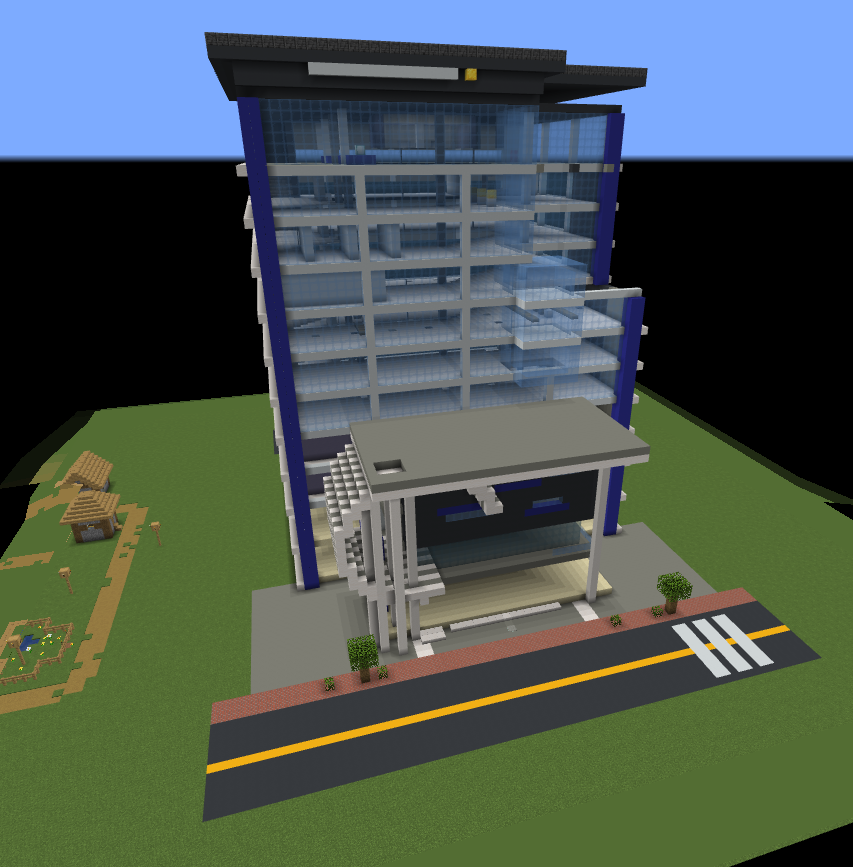

<div align="center">

# 🏛️ IF-BUU 1:1 Craft

**A 1:1 Scale Interactive Digital Twin of the Faculty of Informatics, Burapha University (BUU) — Built for BUU Open House & Innovation Hub 2026**

[English](README.md) | [ภาษาไทย](README.th.md)

[](https://www.minecraft.net/)
[](https://papermc.io/)
[](https://bluemap.bluecolored.io/)
[-F59E0B?style=for-the-badge)](#)
[](LICENSE)
[](#roadmap--v30-status)

<br/>



*3D BlueMap render of **v1.0.0** — featuring the 11-storey tower, iconic curved front podium, 8F–11F step-back wing, rooftop solar arrays, and Fueang Fa Road.*

</div>

---

## 🎉 BUU Open House & Innovation Hub 2026 (`@InformaticsBUU`)

> *"Informatics – A Place Fostering Your Creative Innovations"*

This project is built as a virtual showcase companion for **BUU Open House & Innovation Hub 2026 (BUU69)**:

* 📅 **Date & Time:** **20 – 21 November 2026** | `09:00 – 16:30` (GMT+7)
* 📍 **Venues:** Thamrong Buasri Hall & **7th Floor, Faculty of Informatics Building, BUU**
* 🔬 **7th Floor Innovation Hub & Technology Showcase Highlights:**
  * **AI Vision in Action** — Live Lab Experiment *(Vision Lab)*
  * **Robot Arm Controls** *(Vision Lab)*
  * **AI / AR / VR Application Testing** *(DMI Lab)*
  * **Automation and Industry 5.0 Demo** *(DMI Lab)*
* 🌐 **Official Channels:** [informatics.buu.ac.th](https://informatics.buu.ac.th) | Facebook: *คณะวิทยาการสารสนเทศ มหาวิทยาลัยบูรพา* | YouTube: *Informatics BUU*

---

## ✨ About the Project

**IF-BUU 1:1 Craft** transforms the **11-storey Faculty of Informatics Building (Lecture Center & Administrative Office)** at **BUU (Chonburi, Thailand)** into an explorable **1:1 scale virtual campus** (`1 block = 1 meter`).

Whether visitors explore from **PC (Java Edition)**, **Mobile / iPad (Bedrock Edition)**, or directly in a **Web Browser (3D BlueMap)**, anyone can walk under the iconic curved entrance canopy, ride the working 12-level elevator from **B1 to 11F**, and visit lecture halls, computer labs, the 7th-floor Innovation Hub / FabLab, and the 11th-floor Exhibition Hall.

### 🎯 Why Build This?
* **Cross-Platform Open House Experience:** Welcomes visitors on PC, smartphones, tablets, and web browsers simultaneously.
* **Data-Driven 1:1 Accuracy:** Built using real architectural photography, 28 high-resolution 360° VR Tour panoramas, and Zoom-19 satellite measurements (`0.2906 m/px`).
* **Infrastructure-as-Blocks:** The entire 11-storey structure, staircases, elevator lobbies, and sample interiors are procedurally generated from Python into a pure vanilla **Minecraft Datapack** (`if_buu_1to1`).

---

## 📊 Verified Building Specifications

| Parameter | Real-World Data | Minecraft 1:1 Representation |
| :--- | :--- | :--- |
| **Building Name** | Faculty of Informatics, BUU (Architects 110, 2017) | `if_buu_1to1` Datapack |
| **Coordinates** | `13.281348° N, 100.924111° E` (Fueang Fa Rd.) | Origin `(0, 0, 0)` at front drop-off stairs |
| **Footprint** | ~52 m (N–S) × ~60 m (E–W incl. podium) | `52 × 60` blocks (`48 × 44` tower + `16` podium) |
| **Floors & Area** | 11 storeys + 1 basement (~18,309 sq.m. GFA) | `B1` (`Y=-5`) up to `11F` (`Y=52`) + Roof (`Y=63`) |
| **Rooftop** | 3 solar panel arrays | `minecraft:daylight_detector` arrays |

---

## 🚀 Key Features (v3.0.0 — Complete 1F–11F Floor Plans & True Satellite Orientation)

* **Full 1:1 Floor-Plan Generator (`scripts/floorplans_all.py` & `scripts/generate_datapack.py`):**
  * **True Google Maps / Satellite Orientation:** Aligned directly to real-world satellite imagery (`East +X` Fueang Fa Road & Front Canopy, `West -X` Elevator Spine & Moto Parking, `North -Z` 11F Solar Panels & Restrooms, `South +Z` 6-Ribbed SE C-Arch & `5M210` Wing).
  * **All 11 Storeys Built Room-by-Room from Official Floor Plans:**
    * **1F:** `IF-109` Student Union (`SMO`), Co-Working Space, glass Info Booth & automatic doors, rolling metal shutter + `IF-104`, indoor wheelchair ramp, East study tables, `IF-115`, `IF-112`, `IF-111`, Garbage Room, and SE under-wall motorcycle bay.
    * **2F:** NW green astroturf Outdoor Terrace, `IF-208` Informatics Library, `IF-212` Conference Room, glass-walled `IF-210` & `IF-211` offices, `IF-215`–`IF-219` Executive wing, `IF-223`, `IF-220` Dining/Pantry.
    * **3F & 4F:** Deep computer labs `IF-3C01`–`3C04` / `IF-4C01`–`4C04` and 210-seat Lecture Halls `IF-3M210` / `IF-4M210`.
    * **5F & 6F:** Lecture rooms `IF-5T01`–`5T05` & `IF-6T01`–`6T05`, plus the **2-storey tall `IF-5M210`** hall and 6F striped roof deck.
    * **7F (Open House 2026 Highlight):** Stepped-back terrace, `IF-7T03` **Vision Lab** (AI Vision & Robot Arm Controls), `IF-7T04` **DMI Lab** (AI/AR/VR & Industry 5.0 Demo), `IF-7T05` **FabLab**, and `IF-7T01`–`7T02`.
    * **8F:** Working spaces `IF-8R01`–`IF-8R08` (including `IF-8R08` Eastern Software Park BUU).
    * **9F–11F (Upper Rectangular Crown):** Lecturer offices `IF-908A`–`D` (9F); `IF-1008`–`1011`, `IF-10M32`, and `IF-10M60` Conference Rooms (10F); `IF-1109` and the 280-seat **`IF-11M280` Exhibition Hall** (11F), topped by 3 solar panel arrays on the North roof.
  * **3 Passenger Elevators + 1 Fireman's Elevator + 3 Walkable Staircases (Main, NNW, SE)** connecting all levels.
  * **Campus Context (`09_campus_context`):** Fueang Fa Rd, crosswalk, NW circular fountain, South 5F building, and East Computer Center / Science CL frontage (`generate-structures=false`).
* **Non-OP Open House Elevator (`08_interactive_openhouse`):**
  * Works for every guest in Adventure Mode via `/trigger if_floor set <1..11>` (or `99` for `B1`) and clickable chat directory `/function if_buu:elevator_menu`.
* **Cross-Platform Open-Source Server Stack (`server/`):**
  * Powered by **PaperMC 1.21.11**, **GeyserMC + Floodgate** (Bedrock mobile/iPad support), **FastAsyncWorldEdit (FAWE)**, and **BlueMap** (3D web viewer at port `8100`).

---

## 🛠️ Quick Start

### Option A: Use the 1:1 Datapack in Any Minecraft Java World (1.21+)
1. Clone this repository:
   ```bash
   git clone https://github.com/ffe111/if-buu-1to1-craft.git
   cd if-buu-1to1-craft
   ```
2. *(Optional)* Regenerate the datapack from Python:
   ```bash
   python scripts/generate_datapack.py
   ```
3. Copy `world/datapacks/if_buu_1to1/` into your save's `datapacks/` folder, run `/reload`, stand at ground level (`Y=0`), and execute:
   ```mcfunction
   /function if_buu:build_all
   ```

### Option B: Launch the Full Cross-Platform Open House Server
1. Download **PaperMC 1.21.11**, **GeyserMC**, **Floodgate**, **BlueMap**, and **FAWE** automatically:
   ```bash
   python server/setup_server.py
   ```
2. Create `server/eula.txt` with `eula=true`.
3. Start the server (`server/start_server.bat` on Windows) and run in the server console:
   ```mcfunction
   execute positioned 0 0 0 run function if_buu:build_all
   setworldspawn 1 0 -1
   ```
4. Connect & explore:
   * **Java Edition:** `localhost:25565`
   * **Bedrock (Mobile/iPad):** `<server-ip>:19132`
   * **3D Web Browser:** `http://localhost:8100`

---

## 📁 Repository Structure

```text
if-buu-1to1-craft/
├── LICENSE                      # MIT License
├── README.md                    # English documentation (primary)
├── README.th.md                 # Thai documentation (ภาษาไทย)
├── docs/
│   ├── 01-project-plan.md       # 5-phase execution plan & progress
│   ├── 02-architectural-spec.md # Vertical scale & verified block palette
│   ├── 03-floor-directory.md    # Room inventory & VR Tour mapping (B1–11F)
│   └── images/                  # Build previews & renders
├── data/
│   ├── building_spec.json       # Machine-readable 1:1 building dimensions
│   └── osm/                     # Overpass API campus query & footprint notes
├── scripts/
│   ├── extract_vr_and_arch.py   # Extracts WPVR scene graph & asset URLs
│   ├── download_assets.py       # Downloads reference photos & 360° panoramas
│   ├── fetch_osm_footprint.py   # Queries OpenStreetMap building data
│   └── generate_datapack.py     # Procedural 1:1 Minecraft Datapack generator
├── world/datapacks/if_buu_1to1/ # Ready-to-use Minecraft 1.21+ Datapack
└── server/                      # PaperMC + GeyserMC + BlueMap setup & test suite
```

---

## 🗺️ Roadmap & v3.0 Status

**v3.0.0** completes the full 11-storey 1:1 digital twin from official floor plans and satellite verification:
- [x] **True Satellite & Google Maps Orientation (`East = +X`, `West = -X`, `North = -Z`, `South = +Z`):** Aligned C-Arch, Fueang Fa Road, 6-ribbed SE canopy, and 11F solar arrays to ESRI/Google satellite imagery.
- [x] **Complete Floor-Plan Interiors (`B1`–`11F`):** Mapped all rooms across `1F`–`8F`, `9F` (`IF-908A–D`), `10F` (`IF-1008..1011`, `IF-10M32`, `IF-10M60`), and `11F` (`IF-1109`, `IF-11M280`), plus real 1F shutter/booth details.
- [ ] **Open House Polish (v3.1):** Add custom NPC tour guides, quiz stations, and high-res BlueMap preview renders.

---

## 🙏 Data Sources & Open-Source Credits

* **Architectural Design & Imagery:** [Architects 110 — Lecture Center & Administrative Office, Faculty of Informatics, BUU](https://www.architects110.com/project/lecture-center-administrative-office-faculty-informatics-burapha-university/)
* **Interior & Campus 360° Reference:** [Informatics 360 VR Tour — Faculty of Informatics, BUU](https://www.informatics.buu.ac.th/?page_id=6718)
* **Open-Source Ecosystem:** [PaperMC](https://papermc.io/), [GeyserMC](https://geysermc.org/), [BlueMap](https://github.com/BlueMap-Minecraft/BlueMap), [FastAsyncWorldEdit](https://github.com/IntellectualSites/FastAsyncWorldEdit)
