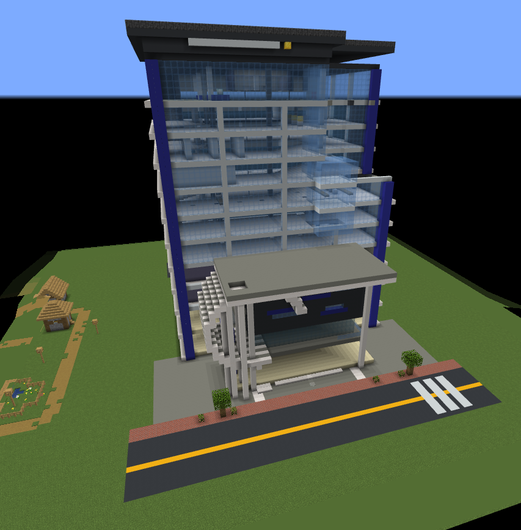

<div align="center">

# 🏛️ IF-BUU 1:1 Craft

**โปรเจกต์จำลองอาคารคณะวิทยาการสารสนเทศ ม.บูรพา (BUU) แบบสเกล 1:1 ใน Minecraft — สำหรับงาน BUU Open House & Innovation Hub 2026**

[English](README.md) | [ภาษาไทย](README.th.md)

[](https://www.minecraft.net/)
[](https://papermc.io/)
[](https://bluemap.bluecolored.io/)
[-F59E0B?style=for-the-badge)](#)
[](LICENSE)
[](#สถานะการพัฒนา-v32-roadmap)

<br/>



*ภาพเรนเดอร์ 3D บน **BlueMap (v1.0.0)** — แสดงตัวอาคาร 11 ชั้น, Podium โค้งด้านหน้า, ส่วนถอยร่น (Step-back) ชั้น 8–11, แผงโซลาร์เซลล์บนดาดฟ้า และถนนเฟื้องฟ้า*

</div>

---

## 🎉 งาน BUU Open House & Innovation Hub 2026 (`@InformaticsBUU`)

> *"Informatics – A Place Fostering Your Creative Innovations"*
> ค้นพบตัวตน สร้างอนาคต ไปกับโลกเทคโนโลยีไร้ขีดจำกัด

โปรเจกต์นี้พัฒนาขึ้นเพื่อร่วมสร้างประสบการณ์โลกเสมือนจริงในงาน **BUU Open House & Innovation Hub 2026 (BUU69)**:

* 📅 **วันและเวลา:** **20 – 21 พฤศจิกายน พ.ศ. 2569** | `09.00 – 16.30 น.`
* 📍 **สถานที่จัดงาน:** ณ หอประชุมธำรงบัวศรี และ **ชั้น 7 อาคารคณะวิทยาการสารสนเทศ ม.บูรพา**
* 🔬 **ไฮไลต์ Innovation Hub & Technology Showcase (ชั้น 7):**
  * **AI Vision in Action** — Live Lab Experiment *(Vision Lab)*
  * **Robot Arm Controls** *(Vision Lab)*
  * **AI / AR / VR Application Testing** *(DMI Lab)*
  * **Automation and Industry 5.0 Demo** *(DMI Lab)*
* 🌐 **ช่องทางอย่างเป็นทางการ:** [informatics.buu.ac.th](https://informatics.buu.ac.th) | Facebook: *คณะวิทยาการสารสนเทศ มหาวิทยาลัยบูรพา* | YouTube: *Informatics BUU*

---

## ✨ เกี่ยวกับโปรเจกต์

**IF-BUU 1:1 Craft** คือโปรเจกต์จำลอง **อาคารเรียนและสำนักงานคณบดี คณะวิทยาการสารสนเทศ ม.บูรพา (ตึก IF 11 ชั้น)** ลงในเกม Minecraft ด้วยสเกลจริง **1:1 (`1 บล็อก = 1 เมตร`)**

ผู้ชมสามารถเข้าสำรวจคณะได้จากทุกแพลตฟอร์ม ทั้ง **คอมพิวเตอร์ (Java Edition)**, **มือถือ/iPad (Bedrock Edition)** หรือเปิดดูโมเดล 3D ได้ทันทีผ่าน **เว็บเบราว์เซอร์ (BlueMap)** พร้อมเดินชมตั้งแต่โถงทางเข้าใต้หลังคาโค้งรูปตัว C กดลิฟต์ขึ้น-ลงได้จริงทั้ง **ชั้น B1 ถึงชั้น 11** ไปจนถึงห้องบรรยายใหญ่ ห้องแล็บคอมพิวเตอร์ โซน Innovation Hub / FabLab ชั้น 7 และห้องนิทรรศการชั้น 11

### 🎯 จุดเด่นของแนวทางการพัฒนา
* **รองรับผู้ชมทุกแพลตฟอร์ม:** เปิดโลกเดียวกันให้เข้าชมพร้อมกันได้ทั้ง PC, มือถือ/แท็บเล็ต และหน้าเว็บ 3D
* **อ้างอิงสัดส่วนจากข้อมูลจริง:** วัดขนาดจากภาพถ่ายดาวเทียม Zoom 19 (`0.2906 ม./พิกเซล`), ภาพถ่ายสถาปัตยกรรมจากผู้ออกแบบ, ภาพพาโนรามา 360° จาก VR Tour 28 จุด และแปลนหนีไฟจริงครบทุกชั้น
* **สร้างโครงสร้างด้วยโค้ด (Infrastructure-as-Blocks):** โครงสร้าง 11 ชั้น บันได โถงลิฟต์ และห้องภายในทั้งหมดถูกสร้างอัตโนมัติจากสคริปต์ Python ออกมาเป็น **Minecraft Datapack** (`if_buu_1to1`) ที่แก้ไขและทำซ้ำได้ทันที

---

## 📊 ข้อมูลอาคารที่สอบเทียบแล้ว (Verified Specifications)

| รายการ | ข้อมูลจริง | สัดส่วนใน Minecraft 1:1 |
| :--- | :--- | :--- |
| **ชื่ออาคาร** | อาคารคณะวิทยาการสารสนเทศ ม.บูรพา (Architects 110, 2017) | Datapack `if_buu_1to1` |
| **พิกัดที่ตั้ง** | `13.281348° N, 100.924111° E` (ถนนเฟื้องฟ้า) | จุดอ้างอิง `(0, 0, 0)` กลางโครงสร้างตึก |
| **ขนาดฐานอาคาร** | กว้าง ~52 ม. × ลึก ~60 ม. (รวม Podium) | `52 × 60` บล็อก (`48 × 44` Tower + `16` Podium) |
| **จำนวนชั้นและพื้นที่** | 11 ชั้น + ชั้นใต้ดิน 1 ชั้น (พื้นที่ใช้สอยรวม ~18,309 ตร.ม.) | `B1` (`Y=-5`) ถึง `11F` (`Y=52`) + หลังคา (`Y=63`) |
| **ดาดฟ้า** | แผงโซลาร์เซลล์ 3 แถว (ฝั่งเหนือ) | แนว `minecraft:daylight_detector` 3 แถว |

---

## 🚀 ฟีเจอร์หลักในเวอร์ชัน 3.1.0 (C-Arch 6 ซี่ & สวนดาดฟ้า & ตึกวิทย์ฝั่งตรงข้ามถนน)

* **ถอดแบบภายในจากแปลนจริงครบ 11 ชั้น (`scripts/floorplans_all.py` & `scripts/generate_datapack.py`):**
  * **จัดทิศทางตาม Google Maps / ภาพถ่ายดาวเทียมจริง:** ตะวันออก (`+X`) = ถนนเฟื้องฟ้า & หน้าตึก Podium, ตะวันตก (`-X`) = แกนลิฟต์-บันไดหลัก & ลานมอเตอร์ไซค์, เหนือ (`-Z`) = ปีกห้องน้ำ & แผงโซลาร์เซลล์บน 11F, ใต้ (`+Z`) = ครีบโค้ง C-Arch 6 แนว & ปีก `5M210`
  * **กั้นห้องและวางผังครบทุกชั้น (B1–11F):**
    * **ชั้น 1:** สโมสรนิสิต `IF-109` (SMO), Co-Working Space, ป้อมกระจก & ประตูทางเข้ากระจก, **ประตูม้วน & `IF-104`**, ทางลาดผู้พิการ, โต๊ะอ่านหนังสือฝั่งตะวันออก, `IF-115`–`111`, ห้องแยกขยะ และที่จอดรถมอเตอร์ไซค์ใต้ตึกฝั่ง SE
    * **ชั้น 2:** ระเบียงหญ้าเทียมสีเขียว 2F, ห้องสมุด `IF-208`, ห้องประชุม `IF-212`, สำนักงานกระจก `IF-210`–`211`, ห้องผู้บริหาร `IF-215`–`219` & `IF-223`, `IF-220`
    * **ชั้น 3 & 4:** ห้องคอมพิวเตอร์ `IF-3C01`–`3C04` / `IF-4C01`–`4C04` และห้องบรรยายใหญ่ `IF-3M210` / `IF-4M210`
    * **ชั้น 5 & 6:** ห้องเรียน `IF-5T01`–`5T05` / `IF-6T01`–`6T05` พร้อมห้องบรรยาย `IF-5M210` **สูงทะลุ 2 ชั้นถึงหลังคาชั้น 6**
    * **ชั้น 7 (ไฮไลต์ Open House 2026):** ถอยร่นเปิดโล่งเหนือ Podium, `IF-7T03` (**Vision Lab**: AI Vision & Robot Arm), `IF-7T04` (**DMI Lab**: AI/AR/VR & Industry 5.0), `IF-7T05` (**FabLab**), `IF-7T01`–`7T02`
    * **ชั้น 8:** ห้องปฏิบัติการและ Working Space **`IF-8R01`–`IF-8R08`** (รวมถึง Eastern Software Park BUU)
    * **ชั้น 9–11 (ตัวอาคารช่วงบน):** ห้องพักอาจารย์ `IF-908A`–`D` (ชั้น 9), ห้องประชุม `IF-10M32` / `IF-10M60` & `IF-1008`–`1011` (ชั้น 10), `IF-1109` และโถงนิทรรศการ **`IF-11M280`** (ชั้น 11) พร้อมแผงโซลาร์เซลล์ 3 แถวบนหลังคาฝั่งเหนือ
  * **ลิฟต์โดยสาร 3 ตัว + ลิฟต์ดับเพลิง 1 ตัว + บันได 3 จุด** (บันไดหลัก, หนีไฟ NNW, หนีไฟ SE) เดินขึ้นลงได้จริงทุกชั้น
  * **บริบทอาคารรอบข้าง (`09_campus_context`):** ถนนเฟื้องฟ้า, ทางม้าลาย, เสาธง 3 ต้น, ตึกวิทย์ (Science CL หลังคากระจก 5 ช่อง) พร้อมสระน้ำวงกลมฝั่งตรงข้ามถนน (East), ตึกเหลือง NE และอาคาร 6 ชั้นฝั่งใต้ (ปิด `generate-structures=false`)
* **ระบบลิฟต์สำหรับผู้เยี่ยมชม (`08_interactive_openhouse`):**
  * ใช้งานได้ทุกคนในโหมด Adventure โดยไม่ต้องมีสิทธิ์ OP ด้วยคำสั่ง `/trigger if_floor set <1..11>` (หรือ `99` สำหรับชั้น B1) และเมนูกดเลือกในแชท `/function if_buu:elevator_menu`
* **ชุดเซิร์ฟเวอร์ Open-Source ข้ามแพลตฟอร์ม (`server/`):**
  * ขับเคลื่อนด้วย **PaperMC 1.21.11**, **GeyserMC + Floodgate** (รองรับมือถือ/iPad), **FastAsyncWorldEdit (FAWE)** และ **BlueMap** (ดู 3D บนเว็บพอร์ต `8100`)

---

## 🛠️ วิธีเริ่มต้นใช้งาน (Quick Start)

### วิธีที่ 1: นำ Datapack ไปวางในโลก Minecraft Java (1.21+)
1. โคลน Repository นี้:
   ```bash
   git clone https://github.com/ffe111/if-buu-1to1-craft.git
   cd if-buu-1to1-craft
   ```
2. *(ไม่บังคับ)* รันสคริปต์สร้าง Datapack ใหม่จาก Python:
   ```bash
   python scripts/generate_datapack.py
   ```
3. คัดลอก `world/datapacks/if_buu_1to1/` ไปใส่ในโฟลเดอร์ `datapacks/` ของเซฟโลก พิมพ์ `/reload` แล้วมายืนที่ระดับพื้น (`Y=0`) จากนั้นรัน:
   ```mcfunction
   /function if_buu:build_all
   ```

### วิธีที่ 2: เปิดเซิร์ฟเวอร์ Open House แบบเต็มรูปแบบ (PC + มือถือ + เว็บ 3D)
1. ดาวน์โหลด **PaperMC 1.21.11**, **GeyserMC**, **Floodgate**, **BlueMap** และ **FAWE** อัตโนมัติ:
   ```bash
   python server/setup_server.py
   ```
2. สร้างไฟล์ `server/eula.txt` แล้วใส่ข้อความ `eula=true`
3. เปิดเซิร์ฟเวอร์ (`server/start_server.bat` บน Windows) แล้วพิมพ์คำสั่งใน Console ของเซิร์ฟเวอร์:
   ```mcfunction
   execute positioned 0 0 0 run function if_buu:build_all
   setworldspawn 30 0 5
   ```
4. ช่องทางเข้าชม:
   * **PC (Java Edition):** `localhost:25565`
   * **มือถือ / iPad (Bedrock Edition):** `<IP เครื่องเซิร์ฟเวอร์>:19132`
   * **เว็บเบราว์เซอร์ 3D:** `http://localhost:8100`

---

## 📁 โครงสร้าง Repository

```text
if-buu-1to1-craft/
├── LICENSE                      # สัญญาอนุญาต MIT License
├── README.md                    # คู่มือหลัก (ภาษาอังกฤษ)
├── README.th.md                 # คู่มือภาษาไทย (ไฟล์นี้)
├── docs/
│   ├── 01-project-plan.md       # แผนการดำเนินงาน 5 เฟสและสถานะปัจจุบัน
│   ├── 02-architectural-spec.md # ตารางความสูงแต่ละชั้นและ Block Palette
│   ├── 03-floor-directory.md    # ทำเนียบห้องและจุด VR Tour (B1–11F)
│   └── images/                  # ภาพเรนเดอร์และตัวอย่างผลงาน
├── data/
│   ├── building_spec.json       # ข้อมูลขนาด/พิกัดอาคารแบบ JSON
│   └── osm/                     # ข้อมูล Overpass API และโน้ตพื้นที่
├── scripts/
│   ├── extract_vr_and_arch.py   # ดึง WPVR Scene Graph และลิงก์รูปภาพ
│   ├── download_assets.py       # ดาวน์โหลดภาพอ้างอิงและพาโนรามา 360°
│   ├── fetch_osm_footprint.py   # ดึงข้อมูลแผนที่อาคารรอบ ม.บูรพา จาก OSM
│   ├── floorplans_all.py        # ผังห้อง 1:1 ครบทุกชั้น 1F–11F ตามแปลนจริง
│   └── generate_datapack.py     # สคริปต์สร้าง Minecraft Datapack 1:1
├── world/datapacks/if_buu_1to1/ # Datapack พร้อมใช้งานสำหรับ Minecraft 1.21+
└── server/                      # ชุดติดตั้ง PaperMC + GeyserMC + BlueMap และสคริปต์ทดสอบ
```

---

## 🗺️ สถานะการพัฒนา (v3.2 Roadmap)

**v3.2.0** ปรับผังพื้นที่รอบอาคารและ Podium ใหม่ตามแผนผังเส้นทางเดินรถของคณะ ภาพ Street View ภาพโดรน และภาพจาก Architects 110:
- [x] **ทางวนรถจอดส่งด้านทิศเหนือ (ตามแผนผังทางการ):** เลนจอดส่งยกระดับขึ้นถึงชั้น 1, เกาะกลางพร้อมต้นไม้, จุดหยุดรอ, โซนระวังรถสวนทาง, ไม้กั้นทางเข้า, เลนรถจักรยานยนต์แยก และลูกศรบนพื้นถนน
- [x] **ที่จอดรถและชั้นใต้ดิน:** ที่จอดรถจักรยานยนต์ด้านหลังอาคาร (ทิศตะวันตก), ที่จอดมอเตอร์ไซค์หน้าอาคารใต้ C-Arch (SE), ทางลาดลงลานจอดรถใต้ดิน B1 พร้อมไฟและรถจอด
- [x] **Podium ตรงตามภาพถ่าย:** แถบกระจกเข้มชั้น 2, กล่องแผงสีเทาชั้น 3–6 พร้อมแถบสีน้ำเงินและหน้าต่าง, หลังคาลอย (Cap) ที่ยอด Podium, เสาขาว 6 ต้นกับช่องแสงวงกลม และครีบ C-Arch 6 ซี่เชื่อมหลังคาลงถึงชายคาชั้น 2 พร้อมสวนบนดาดฟ้า Podium


**v3.1.0** ปรับแก้รูปทรงภายนอกและสภาพแวดล้อมรอบอาคารตามภาพ Street View, หุ่นจำลองสถาปัตยกรรม และ Google Maps:
- [x] **จัดทิศทาง C-Arch หันหาถนนหลักตรงจุด 100%:** ครีบโค้งสีเงิน 6 ซี่, เสา 6 ต้น, เสาธง และ Podium หันหน้าออกสู่ถนนเฟื้องฟ้า (East) โดยมีสระน้ำวงกลม, ตึกวิทย์สีเทา (CL) และตึกเหลืองอยู่ฝั่งตรงข้ามถนน
- [x] **สวนบนดาดฟ้าชั้นพักตัวตามหุ่นจำลอง:** เพิ่มต้นไม้และสวนหย่อมบนหลังคาชั้น 7 และชั้น 9
- [x] **กั้นห้องครบทุกชั้น (`B1`–`11F`):** ครบทั้ง `1F`–`8F` (`IF-8R01..08`), `9F` (`IF-908A..D`), `10F` (`IF-1008..1011`, `IF-10M32`, `IF-10M60`) และ `11F` (`IF-1109`, `IF-11M280`) รวมถึงรายละเอียดประตูม้วนและป้อมกระจกชั้น 1
- [ ] **ตกแต่งเสริมงาน Open House (v3.2):** เพิ่ม NPC พาชมอาคาร, จุดเกมตอบคำถาม และภาพเรนเดอร์ BlueMap ล่าสุด

---

## 🙏 แหล่งข้อมูลอ้างอิงและเครื่องมือ Open-Source

* **แบบและภาพถ่ายสถาปัตยกรรม:** [Architects 110 — อาคารเรียนและสำนักงานคณบดี คณะวิทยาการสารสนเทศ ม.บูรพา](https://www.architects110.com/project/lecture-center-administrative-office-faculty-informatics-burapha-university/)
* **ข้อมูลภายในอาคาร 360°:** [Informatics 360 VR Tour — คณะวิทยาการสารสนเทศ ม.บูรพา](https://www.informatics.buu.ac.th/?page_id=6718)
* **ซอฟต์แวร์ Open-Source ที่ใช้:** [PaperMC](https://papermc.io/), [GeyserMC](https://geysermc.org/), [BlueMap](https://github.com/BlueMap-Minecraft/BlueMap), [FastAsyncWorldEdit](https://github.com/IntellectualSites/FastAsyncWorldEdit)
